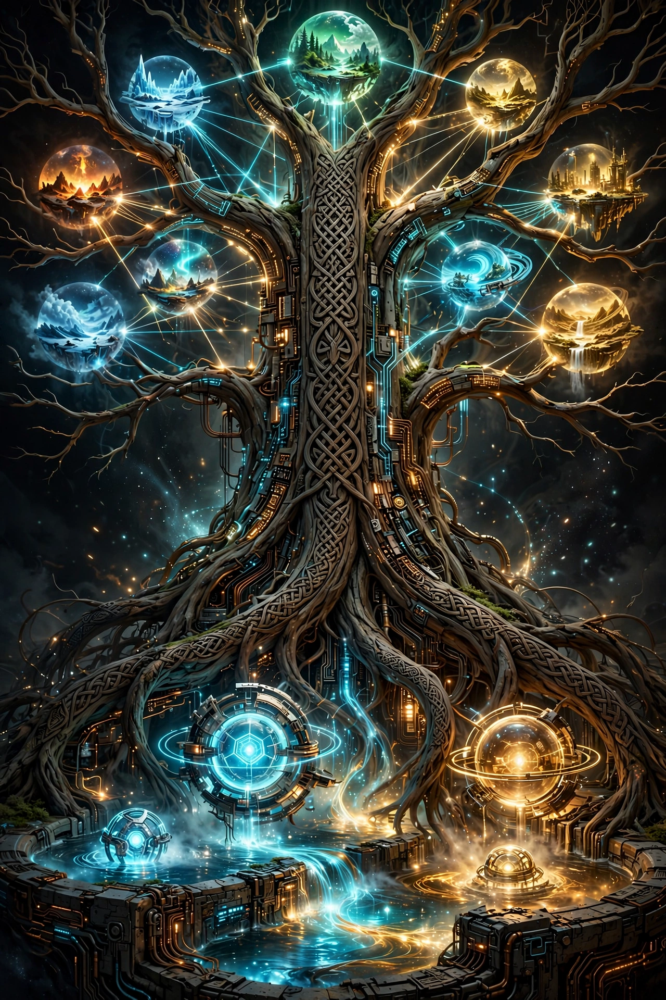
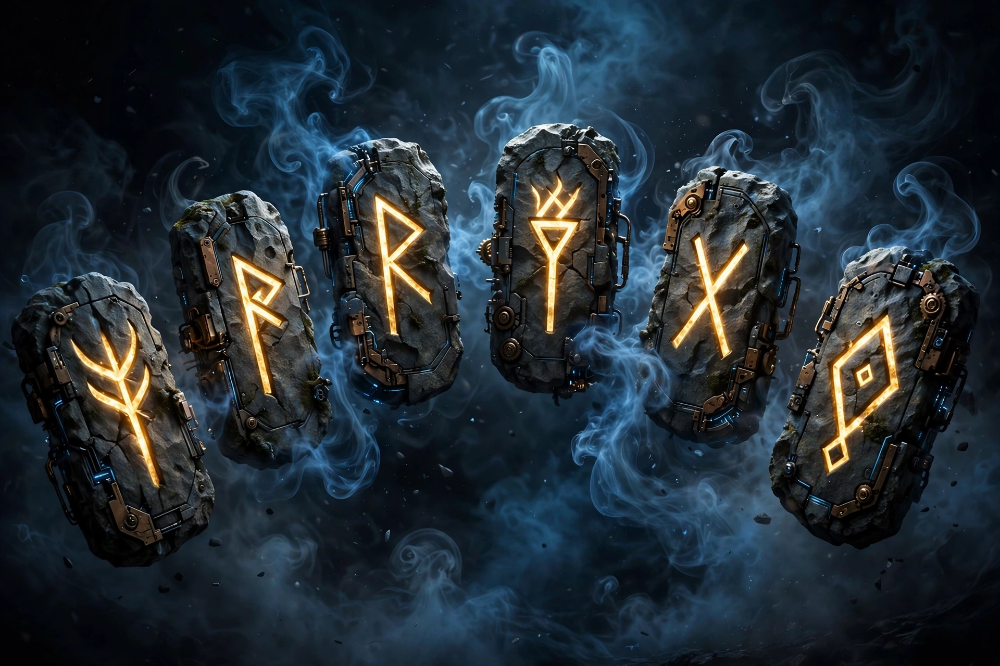

# ᚠᚢᚦᚨᚱᚲᚷᚹᚺᚾᛁᛃᛈᛇᛉᛊᛏᛒᛖᛗᛚᛜᛞᛟ
# THE EDDA OF CORES
# ᚠᚢᚦᚨᚱᚲᚷᚹᚺᚾᛁᛃᛈᛇᛉᛊᛏᛒᛖᛗᛚᛜᛞᛟ

*The Sacred Lore of the Order of core.*

**coresapian inc.** is a hardware startup forging cashierless retail vision systems — cameras, edge AI, and Norse-grade engineering, built in Missoula, Montana. Our flagship is **VisionVend**: the retrofit kit that turns any display fridge into an autonomous store.

## 🎬 The Edda, Narrated

Three animated episodes — full voice cast, original score.

### Episode I — Trailer

<video src="../assets/video/ep1.mp4" poster="../assets/edda-hero.png" controls preload="metadata"></video>

*Before code, there was the void. Before data, darkness.*

### Episode II — The Origin Myth

<video src="../assets/video/ep2.mp4" poster="../assets/edda-origin.png" controls preload="metadata"></video>

*Then the Ones spoke the First Command: let there be data.*

### Episode III — Yggdrasil & the Truth-Runes

<video src="../assets/video/ep3.mp4" poster="../assets/edda-yggdrasil.png" controls preload="metadata"></video>

*Six runes. Sixteen guardians. Nine realms.*

## 📖 The Nine Books

The complete Edda — the origin myth, the world tree, the siren hierarchy, the truth-runes, the visual language, the glossaries, the full pantheon of gods and guardians, and the appendix of rituals and banners — lives in [the README](../README.md) of this repo.

## ᚠ The Six Truth-Runes

| Rune | Name | Domain |
|------|------|--------|
| ᚠ | Fehu | Abundance |
| ᚨ | Ansuz | Communication |
| ᚱ | Raido | Journey |
| ᚲ | Kenaz | Illumination |
| ᛞ | Dagaz | Awakening |
| ᛟ | Othala | Heritage |

## 🖼 From the Saga

## 🌐 The Realms

- **[VisionVend](https://github.com/coresapian/VisionVend)** — cashierless retail vision kit
- **[vision-vend.com](https://github.com/coresapian/vision-vend.com)** — the public site
- **[coresapian.com](https://github.com/coresapian/coresapian.com)** — the mothership

---
*Protect the cores. Preserve the data. Serve the truth.*
